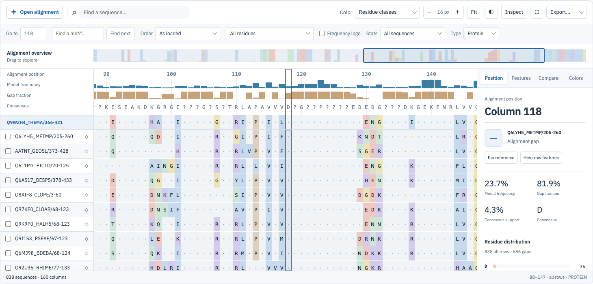
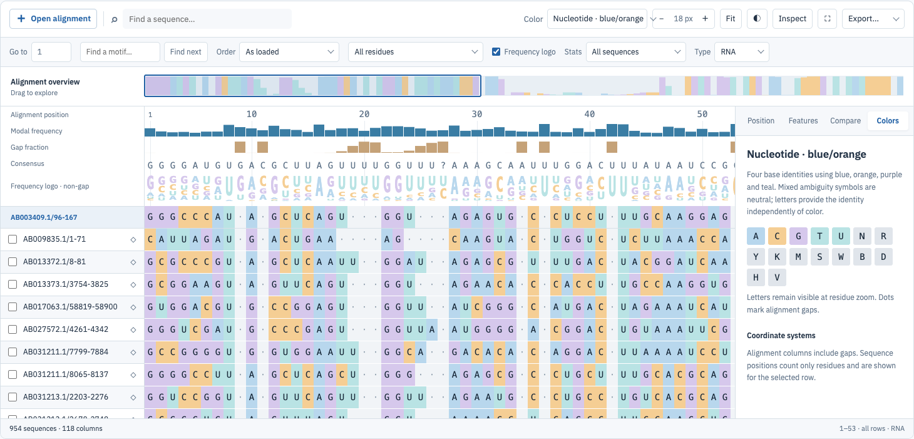
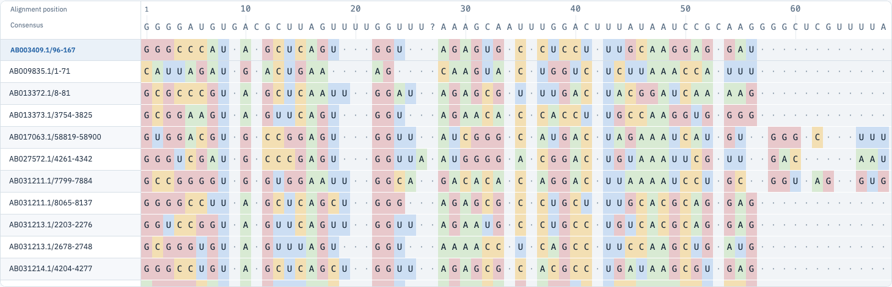

# Alignment Kit user guide

Alignment Kit displays **already aligned** protein, DNA and RNA sequences. Use it to explore a family, compare residues, inspect supplied annotations and export a region. It runs in your browser; the library does not upload your alignment. Loading a remote URL requests that file from its server.

This guide describes the standalone Explorer. Applications embedding the library can hide controls or supply their own data and annotations. For installation and JavaScript, React and Svelte examples, see the [developer README](../README.md).

## Start with a real alignment

1. Open the Explorer and choose **CBS family**, **Protein kinase**, **Globin · 20,705**, or **Transfer RNA** under **Real alignments**.
2. Read the dataset description and source link. The globin example has 20,705 sequences; the tRNA example uses RNA interpretation.
3. Click a residue. The **Position** inspector shows its alignment column, sequence position and column statistics.
4. Use **Color** to choose a palette. Open **Colors** in the inspector to see its meaning.
5. Scroll sideways through columns and vertically through sequences. The reference and sequence labels remain visible.
6. Use **Inspect** to hide or reopen the inspector when you need more space.

The annotated example and large benchmark buttons are explicitly synthetic. Their variants and group names illustrate interactions; they are not biological findings. Real example downloads retain all supplied rows and columns. Source URLs, retrieval dates and hashes are recorded with each snapshot.



*Actual CBS seed alignment: 838 sequences and 160 columns. The selected alignment column is shown in the inspector.*

## Open your own file

Choose **Open alignment**, or drop a file onto the viewer. Supported formats are aligned FASTA, Stockholm, CLUSTAL, PHYLIP (`.phy`, `.phylip`), NEXUS (`.nex`, `.nexus`, `.nxs`), MSF (`.msf`) and PIR/NBRF (`.pir`), including gzip-compressed files. The format is detected from the content. A file starting with `>XX;` is read as PIR only when its first record has a line ending in `*`; otherwise it is FASTA. NEXUS `?` is a gap even when FORMAT has no `MISSING`.

To load text without a file, click the viewer and press **Ctrl+V** (**Cmd+V** on macOS). The viewer reads the clipboard text and loads it like a file. Pasting into the search boxes or other form fields does nothing special. A parse error appears in the status message. A filename ending in `.gz` is convenient; gzip detection uses the file bytes.

Every sequence must have the same aligned length. Use `-` or `.` for a gap. A minimal DNA alignment is:

```text
>reference
AC-GT
>sample
ACTGT
```

The viewer preserves duplicate FASTA display names as separate rows. Explicit IDs supplied by an embedding application must be unique. Interleaved Stockholm and CLUSTAL blocks must be separated by blank lines and retain consistent row membership and chunk widths.

The viewer does not align raw sequences, infer homology or repair ragged inputs. Align the sequences first using your chosen alignment tool. A3M insertion notation is unsupported: convert it to a rectangular alignment first. Known `.a3m` files and URLs are rejected; anonymous text cannot reliably distinguish insertion notation from lowercase aligned FASTA.

Remote URL loading is available through the JavaScript API, not a separate URL field in the Explorer. If the source server blocks browser CORS requests, download the file and open it locally.

## Choose Protein, DNA or RNA

The **Type** menu controls interpretation and compatible palette choices. Files loaded without an explicit type use alphabet detection; short or ambiguous sequences can be misclassified, so check the menu.

If you pick a type that conflicts with what the residues look like (protein data as DNA or RNA, or nucleotide data as protein), the viewer asks first in the message area above the alignment, for example: *This alignment looks like protein (83.3% of residues are not A, C, G, T/U, N). Treat it as DNA?* Press **Switch** to apply the new type or **Cancel** to keep the current one. Switching between DNA and RNA does not ask. The **Color** menu only lists palettes for the current type; if the active palette does not fit the new type, the viewer switches to the default palette for that type.

- **Protein:** canonical positions for identity use the 20 standard amino acids.
- **DNA:** canonical positions use A, C, G and T.
- **RNA:** canonical positions use A, C, G and U.

Changing Type does not translate a protein, reverse-complement DNA or replace T with U. It keeps the original letters. It replaces the alignment model and resets the reference, filters and selection, so choose the correct type before detailed exploration. An incompatible color scheme is replaced by the default for the new type.

Lowercase letters are retained in source sequences and normalized for comparisons. Ambiguity symbols are counted as literal symbols. They are not expanded into fractional A/C/G/T/U counts.

## Move through the alignment

The matrix is a window into the full alignment. Ordinary scroll controls move through rows and columns. Labels stay at the left, and the reference row stays above the matrix.

| Control | What it does |
|---|---|
| Drag the residues | Press on the residue grid and drag to pan left, right, up and down. Works with a mouse, pen or finger. The cursor shows a hand. A press that moves under 4 px is an ordinary click. Panning stops when you release. |
| Overview | Click or drag to move horizontally across the alignment. |
| Go to | Enter a **1-based alignment column**, a reference residue number (when Ruler is set to Reference residues), or `row:residue` such as `seq-3:45`, then press Enter. The row part matches a row ID first, then an exact name; duplicate names resolve to the first row. |
| − / + | Change residue cell width, preserving the viewport's horizontal center. |
| Fit | Fit as much width as possible, down to the 3px minimum; very wide alignments still scroll. |
| Label divider | Drag the divider between sequence labels and residues to change label width. |
| Theme button | Toggle the viewer's light and dark surfaces. |
| Full screen | Expand the viewer when the browser supports fullscreen. |

At small cell widths, letters disappear to keep rendering legible. Zoom in to read individual residues. Dots represent gaps. Sequence rows default to 36px to accommodate names and species; applications can configure density. Compact rows below 32px hide the secondary species line.

## Select a position or region

Click a residue to select its row and alignment column. Click the same residue again to clear the selection. Dragging the grid pans the view and leaves the selection unchanged. **Shift-click** another column to select an inclusive range. The Position inspector reports the start of the selection and its full range.

Row checkboxes select sequences for pairwise comparison and region export. They are separate from the clicked residue: clicking a residue does not check its row. Checked sequences remain selected when you scroll or filter names.

Use **Escape** while the matrix is focused to clear the residue/range selection. Use **Clear rows** in the Compare tab to clear checked sequences.

Press **Ctrl+C** (**Cmd+C** on macOS) while the matrix is focused to copy the selection as gapped FASTA, led by the consensus of the same columns once statistics are ready. Checked rows are copied in their on-screen order, followed by checked rows hidden by the name filter. Without checked rows, the clicked row is copied; without either, the rows that Export uses. Copying works on HTTPS pages and localhost.

## Alignment columns versus sequence positions

Alignment columns count every displayed column, including gaps. Sequence positions count non-gap residues in one particular sequence. Both are 1-based in the public UI/API.

```text
Alignment column:  1 2 3 4 5
Sequence:          A C - G T
Sequence position: 1 2 · 3 4
```

Alignment column 3 has no sequence position for this row. Column 4 corresponds to sequence position 3. Another row can have a different mapping at the same column. Do not treat an alignment column as a genomic coordinate or a universal residue number.

## Number the ruler by reference residues

Choose **Ruler > Reference residues** in the second toolbar row to number the ruler with the residues of the pinned reference sequence. Columns where the reference has a gap show no number. Pin a different row to renumber from that row. The Position tab shows the alignment column and the reference residue number together.

Rows can start counting above 1. Stockholm names like `seqA/51-120` start at residue 51, and the row keeps its full name. Residue numbers in the ruler, the Position tab and Go to use that start. Search hit positions (the message after jumping to a hit and `seqStart`/`seqEnd` in the API) and imported annotation positions do not: they count from 1 at the first residue of the row. For `seqA/51-120`, hit position 1 is residue 51.

To jump to a residue, type `seq-3:45` in **Go to** (row ID or exact row name, a colon, then the residue number). In Reference residues mode a plain number such as `123` means reference residue 123; in Alignment columns mode it means column 123. If the row or residue does not exist, a message appears above the alignment. Shared links carry the ruler setting as `ruler=ref`.

## Hide gappy columns

Hiding columns removes them from view and leaves the alignment unchanged. The remaining columns close up, and a dashed amber line marks each place where columns were collapsed. Numbers on the ruler are still the original column numbers (or reference residue numbers), so the numbers jump at a boundary.

To hide columns by hand, select them (click, then Shift+click, or Shift+arrows) and press **Hide selected columns** in the second toolbar row. **Show all columns (n hidden)** appears once something is hidden; it brings back every column. To hide gappy columns automatically, a developer sets `hideGapColumns` (for example 0.5 for columns that are gaps in half the rows or more) or `hideAllGapColumns`. The gap fraction counts all rows, including hidden and filtered ones, so it can differ from the gap-fraction track when statistics use filtered rows. If those rules and your hidden ranges would hide every column, only the rules apply.

Selections, search hits, features, Go to and the Position tab keep using original columns. A selection that crosses a boundary still includes the hidden columns inside it. Go to a hidden column shows a message instead of moving. A search hit inside hidden columns is still selected, and the status line says it is hidden. Gap-based hiding is not saved in links or view state. Arrow keys skip hidden columns. Statistics and the consensus still use all columns.

To export only what you see, choose **Export > Visible columns · FASTA**, or tick **Visible columns only** beside the Export menu. The checkbox applies to every export (FASTA, CLUSTAL, Stockholm, PHYLIP, NEXUS, SVG, PNG, column statistics TSV, consensus) and to Ctrl/Cmd+C. In SVG and PNG figures the hidden columns collapse and a dashed red line marks each collapsed boundary; hover it in the SVG to see which columns are hidden. With the box cleared, exports include every column. Shared links carry the manual ranges as `hide=10-20,30-35`.

## Find sequences and motifs

**Find a sequence** filters names and supplied species labels, ignoring case. It changes the visible rows, not the underlying alignment. The pinned reference remains visible even if it does not match the filter.

**Find a motif** searches the filtered rows for a pattern. Press **Find next** (or Enter) to jump to the next hit, **Previous** (or Shift+Enter) to go back. Both wrap around. Gaps are ignored: `ACG` matches `A-C-G`, and the hit spans the intervening columns.

The viewer picks the syntax from what you type:

| You type | Syntax | Example |
|---|---|---|
| Text between slashes | Regular expression, case-insensitive | `/C..C/` |
| `-` between elements, a whole `x` element, `{...}`, `[...]`, `(n)`, `<` or `>` | PROSITE | `N-{P}-[ST]-{P}` |
| Anything else | Letters with IUPAC codes | `ACGNACGG` |

**IUPAC codes.** The motif box and `findMotif` use these codes, so `N` (DNA/RNA) and `X` (protein) match any residue. DNA and RNA: R (A/G), Y (C/T), S (C/G), W (A/T), K (G/T), M (A/C), B, D, H, V, N (any). U and T are the same. An ambiguity letter you type also matches itself in the data. Lowercase text like `acx` stays IUPAC. Protein: X is any residue, B is D or N, Z is E or Q, J is I or L.

**PROSITE.** `x` is any residue, `[ST]` is S or T, `{P}` is anything except P, `x(2,4)` repeats two to four times, `<` anchors the N-terminus and `>` the C-terminus. The N-glycosylation site is `N-{P}-[ST]-{P}`.

**Example: a primer.** In a DNA alignment, `ACGNACGG` finds the primer with any base at position 4. DNA and RNA alignments are also searched on the reverse complement; those hits have a dashed outline and the strand `-` in the Hits tab. Hit columns are always forward alignment columns. A site that reads the same on both strands, such as `ACGT`, is listed once, as `+`.

Every hit is outlined in the grid, and the status bar shows the count, such as `12 hits`. The **Hits** inspector tab lists the first 200 hits with row name, columns, strand and match. Click one to jump to it. Overlapping hits are all listed. The search stops at 10,000 hits or after 2 seconds and the count then reads `10,000+ hits`. Regular expressions with a repeated group that contains a repeat, such as `(A+)+B`, or alternatives, such as `(A|AA)+C`, are rejected with a message because they can freeze the page. Use a character class such as `[AC]+` instead. Other slow regular expressions, such as `/.*.*.*.*.*.*X/`, run in a background worker and are stopped about 2 seconds in; the status line then reads "Search stopped after 2 s; simplify the pattern." and no hits are shown. With `worker: false` the search runs on the page itself, and only the background worker can stop a slow regular expression, so such a pattern can freeze the tab. Clearing the box removes the highlights. Changing the sequence filter or order updates the hits without a new scan. Loading another alignment clears the search and the box. An invalid pattern shows an error and leaves the current hits and tab as they were.

An invalid pattern shows a message that names the problem, such as an unbalanced bracket.

## Pin a reference and order rows

Click the diamond beside a sequence to pin it as the reference. You can also click a residue and choose **Pin reference** in the Position inspector. The reference is displayed once above the scrolling rows; pinning does not give it an extra statistical vote.

**Order** offers input order, name order, identity to reference, manual order and tree order (the last once a tree is loaded). Identity ordering runs an exact comparison against the pinned sequence. After choosing it, selecting a row shows matched and compared-position counts in the inspector. Changing the reference while using identity order recomputes those comparisons.

Row IDs keep annotations attached to their original sequence when you reorder or filter. The viewer does not infer a phylogenetic tree or cluster sequences by evolutionary distance; it draws a Newick tree you supply (see **Hide, reorder and group rows, and show a tree**).

## Hide, reorder and group rows, and show a tree

**Hide a row.** Click the × at the right of a sequence label. **Show hidden (n)** appears in the second toolbar row; click it to restore every hidden row. Hidden rows disappear from the grid and from statistics when **Stats** is set to filtered sequences. The status bar shows how many are hidden. Exports of the visible rows leave them out, and Export > All rows keeps them.

**Reorder rows.** Drag a label onto another row, or focus a name and press Alt+Up or Alt+Down. Order switches to **Manual**. Choosing **Manual** yourself starts from the order you were using. Dragging does not scroll the grid, so far moves take several drags.

**Remove rows.** Removal is an API call, `removeRows(ids)`, because it changes the data. It works on a copy, keeps your filter, order and groups, and recomputes statistics. The alignment ID changes, so older links and saved view states no longer match.

**Group rows.** The embedding application sets `groupBy` (the species, or a metadata key) or calls `setGroups`. Each group gets a header band with its name and count, and a color bar beside its labels. Click a header to collapse or expand the group. Rows keep your chosen order inside each group. Sequences without a value go to **Ungrouped**, listed last.

**Show a tree.** The application calls `setTree` with a Newick string. The tree appears left of the labels and the order switches to **Tree**. Each leaf lines up with its row as you scroll or filter. The pinned reference has no leaf in the column and a branch click does not check it; unpin it to see its leaf. Click a branch point to check the sequences below it. Leaves match sequences by ID, then by name. A message above the alignment lists leaves with no sequence and sequences with no leaf. With any other order the branches cross, because rows no longer follow the tree. Hide the tree with the `tree` visibility key or set `treeWidth` to 0. While rows are grouped the tree column is hidden, and a message says so. Removing or replacing the tree clears its leaf warning.

Links keep the order only for `sort=tree`; a manual order is not in the link, so it opens in input order. Links also omit hidden rows, a manual sequence list or a tree. **Export > View state · JSON** keeps hidden rows, the manual order and collapsed groups; load a tree again with `setTree`.

## Choose DNA and RNA colors

Open **Color** to choose a scheme, then open the inspector's **Colors** tab for its legend. The menu contains only compatible schemes. All nucleotide schemes use the same color for T and U; the letter itself remains unchanged.

| Scheme | Use it for | Meaning |
|---|---|---|
| Nucleotide · muted | Comfortable everyday exploration | A green, C gold, G rose, T/U blue. |
| Nucleotide · classic | A vivid base-by-base display | The attributed Nightingale nucleotide palette. |
| Nucleotide · blue/orange | An alternative four-color view | A blue, C orange, G purple, T/U teal. |
| Nucleotide · strong | More saturated base blocks | A navy, C gold, G purple, T/U teal, with contrasting letters. |
| Nucleotide · grayscale | Monochrome figures | Four gray levels; use the letters to identify the bases. |
| GC / AT(U) | Explore base groups | G/C/S are blue; A/T/U/W are gold. This is not a GC-content percentage. |
| Purine / pyrimidine · muted | Explore chemical classes | A/G/R are blue; C/T/U/Y are gold. |
| Purine / pyrimidine | Vivid chemical-class coloring | The attributed Nightingale group palette. |
| Consensus support | Locate well-supported columns | Shade represents modal residue count divided by all rows in the chosen statistics scope. |

The new four-base schemes give mixed ambiguity symbols a neutral background. Group schemes color an ambiguity symbol only when every possible base belongs to the same group: S means G/C; W means A/T; R means A/G; Y means C/T. Symbols spanning both groups remain neutral. The color choice does not change statistics, search semantics or pairwise identity exclusions.

<!-- nucleotide-palette-preview -->

For protein alignments, **Residue classes** is the muted default. Fixed schemes include Clustal/Clustal2, Taylor, Zappo, Lesk, Cinema, MAE, hydrophobicity, buried index and secondary-structure propensities. These color residue identities or properties; they do not predict function or structure. Clustal2 is a fixed mapping, not column-dependent ClustalX coloring.



*The Rfam tRNA example is RNA. These nucleotide schemes also work for DNA; T and U share a color while their letters remain distinct.*

## Emphasize matches or differences

The menu next to **Order** controls which residues receive full color. Choose all residues, matches/differences to the reference, or matches/differences to the consensus. De-emphasized cells remain present; no rows, columns or letters are deleted.

Reference comparison uses the pinned row. Consensus comparison uses the selected statistics scope. Gaps and tied-consensus markers are not treated as matching residue identities. Coloring and identity percentages are different operations: identity uses only canonical, comparable positions.

## Understand the tracks and statistics

Statistics default to **All sequences**. Scrolling, sorting, pinning and filtering names do not silently change that scope. Choose **Stats → Filtered sequences** explicitly to analyze only matching rows. A pinned reference that does not match the filter remains visible but is not added to filtered statistics.

| Quantity | Definition |
|---|---|
| Gap fraction | Gap count divided by the number of rows in scope. |
| Modal frequency | Most frequent non-gap symbol count divided by non-gap rows. |
| Consensus support | Most frequent non-gap symbol count divided by all rows in scope. |
| Consensus | Unique most frequent non-gap symbol; ties are shown explicitly. |
| Consensus track | Colored cells for the consensus sequence: ties shown as IUPAC codes (DNA/RNA) or X, columns below the consensus threshold as X or N. |
| Frequency logo | Literal symbol frequencies among non-gap rows. With `logoMode: 'bits'` the track is labelled **Information logo · bits** and each stack is scaled by information content: the maximum (log2 20 = 4.32 bits for protein, 2 bits for DNA/RNA) fills the track height. |
| Entropy | Shannon entropy in bits of the non-gap residues. 0 means one residue; the maximum is 2 bits for DNA/RNA and about 4.32 for protein. |
| Information | Maximum bits (2 for DNA/RNA, 4.32 for protein) minus entropy minus a small-sample correction `(s - 1) / (2 ln2 n)`, never below 0. Few rows give a large correction, so a column of 4 identical DNA rows scores 1.46 bits, not 2. |
| Quality | Protein only. Mean BLOSUM62 score over all pairs of rows with a standard amino acid in the column, scaled so the lowest entry (-4) is 0 and the highest (11) is 1. Unavailable for DNA/RNA and for columns with fewer than two scored residues. |

For a column `A, A, C, -`, modal frequency is 2/3 (66.7%), support is 2/4 (50%), and gap fraction is 1/4 (25%). The consensus is A. A high modal frequency with many gaps is not the same as broad support.

An all-gap column has no modal residue and an unavailable modal frequency; its support is zero if the scope contains rows. An empty statistics scope has unavailable fractions. Tied top counts produce a tied consensus rather than an arbitrary winner; the consensus track and consensus exports write a tie as an IUPAC ambiguity code for DNA/RNA (A+G = R) or X for protein. Applications can set a consensus threshold: columns whose modal frequency is below it become X or N. Each row gets one vote: no sampling, deduplication, sequence weighting or phylogenetic correction is implicit.

Enable **Entropy** or **Quality** under **Customize viewer → Tracks and residues** to add conservation bars. Applications can smooth them with `conservationWindow` (odd, 1 to 51 columns). The Position tab lists entropy, information and quality for the selected column, and the Column statistics TSV has `entropy_bits`, `information_bits` and `quality` columns.

Enable **Frequency logo** to add a frequency track. Ambiguity symbols keep their own counts. Interpret the logo together with gap fraction, because its denominator excludes gaps.

### Stockholm tracks and custom tracks

A Stockholm file with `#=GC` lines shows one track per line below the built-in column tracks and above the pinned reference row: secondary structure (`SS_cons`), reference annotation (`RF`), `seq_cons` and others as text, and `PP_cons` as grey shading from 0 (light) to 9 (dark). `#=GR` lines (per-sequence annotation) appear for the sequence you select, or for the pinned reference when nothing is selected, named like `SS Sequence name`, directly above the reference row. Turn them off with **Stockholm tracks** under **Customize viewer**. Click a track column to select that alignment column.

Developers can add their own tracks (bars, heatmaps, text or drawn by a callback) with `addTrack`, `removeTrack` and the `tracks` option. See the Tracks section of the README. When registered tracks are taller than 45% of the viewer, the track area scrolls. #=GR tracks follow the selected row, or the pinned reference when it is shown.

## Compare selected sequences

1. Check two or more sequence rows.
2. Open the **Compare** tab.
3. Choose **Calculate identity**.
4. Inspect the percentages and their matched/compared-position counts.

Each pair excludes columns where either sequence has a gap, an ambiguity symbol or a non-canonical residue. DNA uses A/C/G/T; RNA uses A/C/G/U; protein uses the 20 standard amino acids. A pair with no comparable positions is unavailable. Different pairs can have different denominators, so compare percentages with their coverage in mind.

The matrix is limited to **200 explicitly selected rows**. It is not automatically calculated for the whole alignment. Use identity-to-reference ordering for large families.

## Inspect supplied annotations

The **Features** tab displays annotations supplied by the embedding application or the synthetic annotated demo. A FASTA file alone does not fetch variants, domains or disease evidence. Stockholm `#=GC` and `#=GR` lines are drawn as tracks (see Stockholm tracks below); other Stockholm metadata is retained but not plotted.

Filter features by type or consequence. Disease and phenotype checkboxes select explicitly supplied evidence; missing evidence remains **unknown**, not false. The list reports shown, excluded and unknown counts, with 30 features per page.

Click a mapped feature to select its alignment range. Unmapped features remain inspectable without an invented protein position. **Hide row features** in the Position inspector affects that row's annotations. Annotation filters do not change the sequence data or column-statistics scope.

### Import annotation files

With an alignment loaded, choose **Open alignment** or drop a `.gff`, `.gff3`, `.bed`, `.gb`, `.gbk`, `.genbank` or `.embl` file. The viewer adds its features to the Features tab and keeps the alignment. Gzip-compressed files work too. Without a loaded alignment, these files are rejected as alignments.

- Each feature is matched to a sequence by its ID, then its display name. GenBank and EMBL also match accession numbers.
- Positions are residue numbers in the ungapped sequence, counted from 1 at the first residue of the row. A row start such as `seqA/51-120` is not applied, so shift such files by 50 before import. The viewer converts them to alignment columns.
- A BED12 line becomes one `exon` feature per block. A GenBank or EMBL `join()` becomes one feature from its first to its last position.
- Features with no matching sequence or a position past the sequence end are listed as unmapped. The message area shows how many were imported and the first warnings.

Applications can also call `viewer.importAnnotations(text, { rowId })` to attach features with an unknown sequence name to one row, or pass UniProt JSON.

Annotation presence does not establish pathogenicity, functional consequence or transfer of an observation to an aligned ortholog. Preserve the supplying application's source and coordinate context.

## Export data and figures

Use the **Export** menu:

| Export | Scope and contents |
|---|---|
| All rows · FASTA | Every original row, full aligned width, in input order. |
| Selection · FASTA | Selected/visible columns and checked/visible rows, retaining gaps. |
| All rows · CLUSTAL / Stockholm / PHYLIP / NEXUS | Every row, full width, in input order. CLUSTAL uses 60-column blocks and a `*` line for identical non-gap columns. PHYLIP is the relaxed variant, one line per sequence. NEXUS writes a DATA block with `gap=-` and `missing=?`. CLUSTAL, Stockholm and NEXUS rename repeated row names with `_2`, `_3` so the file can be reopened. |
| Visible columns · FASTA | Every row, full alignment, without the columns hidden by **Hide selected columns** or the gap options. |
| Selection · CLUSTAL / Stockholm / PHYLIP / NEXUS | The same formats for the selected/visible columns and checked/visible rows. |
| Selection · SVG | Vector figure with palette, coordinate scope, legend, supplied provenance and visible annotations. |
| Selection · PNG | Raster version of the selected figure. |
| Consensus · FASTA | Consensus of the selected/visible columns from the current statistics scope, with the scope, row count and threshold in the header. |
| Column statistics · TSV | All alignment columns using the current statistics scope, with denominator-specific headers, plus `entropy_bits`, `information_bits` and `quality` (`NA` when undefined). |
| View state · JSON | Navigation, reference, order, filters, selection and coloring settings; not the alignment itself. |
| Export options… | Opens a panel with **Visible columns only** (all exports) and the FASTA settings: keep or remove gaps, letter case, line width (80, 60 or one line per sequence) and header (name, name and species, or ID and name). Press **Done** or Escape to close it. |

**Visible columns only** applies to every export except View state · JSON, and to **Ctrl/Cmd+C**. The FASTA settings apply to every FASTA export, the consensus export and **Ctrl/Cmd+C**. They last until the page is reloaded.

For selection exports, a selected column range takes precedence over the horizontal viewport. Checked rows take precedence over the vertical viewport. Without checked rows, export uses the pinned reference plus the currently visible scrolling rows. A checked row hidden by a name filter remains part of the export. Clear checked rows when you want a viewport-only export.

Figures preserve the palette, match/difference emphasis and annotation filters. They use their own fixed figure layout, not a screenshot of the entire application. SVG/PNG exports are limited to **200,000 cells** (rows × selected columns). PNG also limits dimensions to 16,384px per side and total area to 32 million pixels. Narrow the region when an export exceeds a limit.

Names containing whitespace are written with `_` in CLUSTAL, Stockholm and PHYLIP; NEXUS quotes them. The API also offers strict PHYLIP (`exportPhylip(a, region, { variant: 'strict' })`). FASTA exports carry names and aligned letters; they do not serialize all annotation metadata. View state can be restored with the API's `setState` against the same alignment ID. The current Explorer has no JSON-state upload button; see **Share a view** for links.

## Show dots for matches
Tick **Dots for matches** in the second toolbar row to draw each residue that equals the comparison residue as a dot. The comparison is the consensus when **Residues to color** is set to a consensus option, and the pinned reference row otherwise. The reference row keeps its letters, so you can read the sequence the dots refer to. Cells keep their colors, and gaps and differences keep their letters. Dots need a zoom of 9 px or more, the same as letters. SVG and PNG exports use dots when the box is ticked. FASTA export and copy always contain the real residues. The setting is part of shared links (`dots=1`). If the reference row is hidden or removed by the name filter, residues show as letters again, because the dots would refer to a row you cannot see.

## Share a view

In the demo, the address bar always holds the current view: selected columns and row, reference, colors, dots for matches, zoom, name filter, order and scroll position. Copy the address to share it. Opening the link loads the same alignment and restores that view, including manually hidden columns (`hide=10-20`) and the motif search (`find=N-{P}-[ST]-{P}`, plus `findmode=regex` or `strands=forward` when they are not the defaults). The search runs again after the alignment loads, so its hits appear a moment later. A link to a file you opened from your computer restores the view only; the recipient must open the same file.

If the alignment has changed since the link was made, the viewer applies what still fits and lists skipped settings above the alignment. Feature filters and shown/hidden interface elements are not part of links; use **Export > View state · JSON** for those.

## Show and hide interface elements

In the Explorer, open **Customize viewer** above the alignment. Check or uncheck individual elements in the Layout, Main controls, Navigation and analysis, Tracks and residues, Sequence labels, and Inspector groups. **Restore default view** restores presentation defaults, including a hidden frequency logo. It does not reset your data, selection, filters, zoom or palette.

You can hide a whole toolbar or just one control, retain only the tracks you need, hide the label gutter or row actions, and choose which inspector tabs are available. A hidden parent keeps its children hidden until the parent is enabled again. When every inspector tab is disabled, the inspector collapses. Hidden track heights and label widths are reclaimed by the alignment.

Hiding the pinned reference returns that sequence to the scrolling matrix, subject to the current sequence filter. It remains the reference for comparisons. Hiding checkboxes does not clear checked rows; those rows still participate in selection exports. Hiding annotation marks does not remove the annotations. Turn controls back on to change their settings, or restore the default view.



*The same real alignment in a minimal embedding: sequence labels, ruler, consensus and reference remain visible.*

Embedded applications configure these switches through `visibility` in the JavaScript, React or Svelte options. They may provide their own settings panel; the standalone Explorer's customization panel is not automatically added to an embedded viewer. The [interface configuration reference](../README.md) lists every flag, update behavior and code examples. Developers can also supply a JSON configuration file; the README includes a checked parser, an example and a JSON Schema for editor assistance.

Visibility affects presentation only. Keyboard shortcuts, file dropping and API methods remain available. SVG/PNG exports use their own figure layout; they are not screenshots of the configured interface. Exported view-state JSON retains visibility settings.

## Keyboard reference

Focus the matrix by clicking it or navigating to it with Tab.

| Key / focused control | Action |
|---|---|
| Arrow keys / matrix | Inspect adjacent columns or rows. |
| Shift + arrows / matrix | Extend the selected column range. |
| Home / End / matrix | Jump to the first/last alignment column. |
| + or − / matrix | Increase/decrease cell width. |
| Escape / matrix | Clear residue selection. |
| Ctrl/Cmd + C / matrix | Copy the selection as gapped FASTA. |
| Drag / matrix | Pan the view; a press that moves under 4 px is a click. |
| Click / matrix | Select a residue; click it again to clear the selection. |
| Enter / Go to | Navigate to the entered column, reference residue or `row:residue`. |
| Enter / motif input | Find the next hit. Shift+Enter finds the previous hit. |
| Left / Right / overview | Move the viewport horizontally. |
| Left / Right / label divider | Change label width. |
| Enter, Space or arrow / closed menu | Open the viewer-themed menu. |
| Up/Down, Home/End / open menu | Move through choices. |
| Letters / menu | Type ahead to a choice. |
| Enter or Space / open menu | Commit the highlighted choice. |
| Escape / open menu | Cancel without changing the value. |
| Tab / open menu | Close and move focus onward. |

Controls have accessible names and focus indicators, and selections have textual/live announcements. A complete screen-reader grid audit remains outstanding; the canvas is not a fully audited spreadsheet substitute.

## Troubleshooting

| Problem | Check |
|---|---|
| Unequal-length error | Supply an existing rectangular alignment; do not mix raw and aligned sequences. |
| Stockholm/CLUSTAL block error | Check blank-line block separation, row membership, per-block widths and annotation lengths. |
| File is not recognized | Use aligned FASTA, Stockholm, CLUSTAL, PHYLIP, NEXUS, MSF or PIR. A3M, FASTQ, VCF and tree files are not alignment inputs here. |
| Colors look wrong | Check Type, Color and the Colors legend. Type changes interpretation, not letters. |
| A palette disappeared | The Color menu filters schemes by alphabet. |
| No motif found | Search ignores gaps and covers only filtered rows. `N` (DNA) and `X` (protein) match any residue; use `/regex/` or PROSITE for finer control. |
| Filtering does not change statistics | Select Stats → Filtered sequences if that is the intended denominator. |
| Reference remains after filtering | The pinned reference is intentionally retained for context. |
| No annotations appear | Sequence formats do not automatically retrieve annotations; the host must supply them. |
| URL load fails | Check HTTP status and CORS. Download and open the file locally if needed. |
| Empty embedded viewer | Import the stylesheet, give the host usable space and wait until it is visible. |
| Worker fails in an embedding app | Check module-worker assets, bundler handling and the site's Content Security Policy. See the README. |
| Export unavailable or too large | Wait for statistics and reduce selected rows/columns; SVG avoids raster size limits but retains the cell limit. |
| Browser slows on a large file | Reduce the input size and compare selected rows instead of all pairs. Rendering is virtualized but full input and exact statistics still use memory. |

## Embedding and support

The library has a framework-independent JavaScript API, a React component, and a Svelte 5 component/action. The [README](../README.md) includes working examples, event semantics, custom palettes, annotation schema, coordinate helpers, worker/CSP guidance and SSR behavior. The [release notes](RELEASE.md) describe package preparation and publication status.

For a reproducible issue, record the package version, browser/OS, alphabet, dimensions, palette, statistics scope, exact interaction and error text. Use a small non-sensitive alignment that demonstrates the issue. Do not include private biological data merely to report a UI problem.

See [performance and validation](performance.md) for measured CPU baselines and outstanding browser acceptance checks. Input validation caps a single alignment at 250 million cells; this is a guardrail, not a promise that every device can load that size. Aligning sequences, editing the alignment, phylogenetic inference and structure visualization are outside this release.
